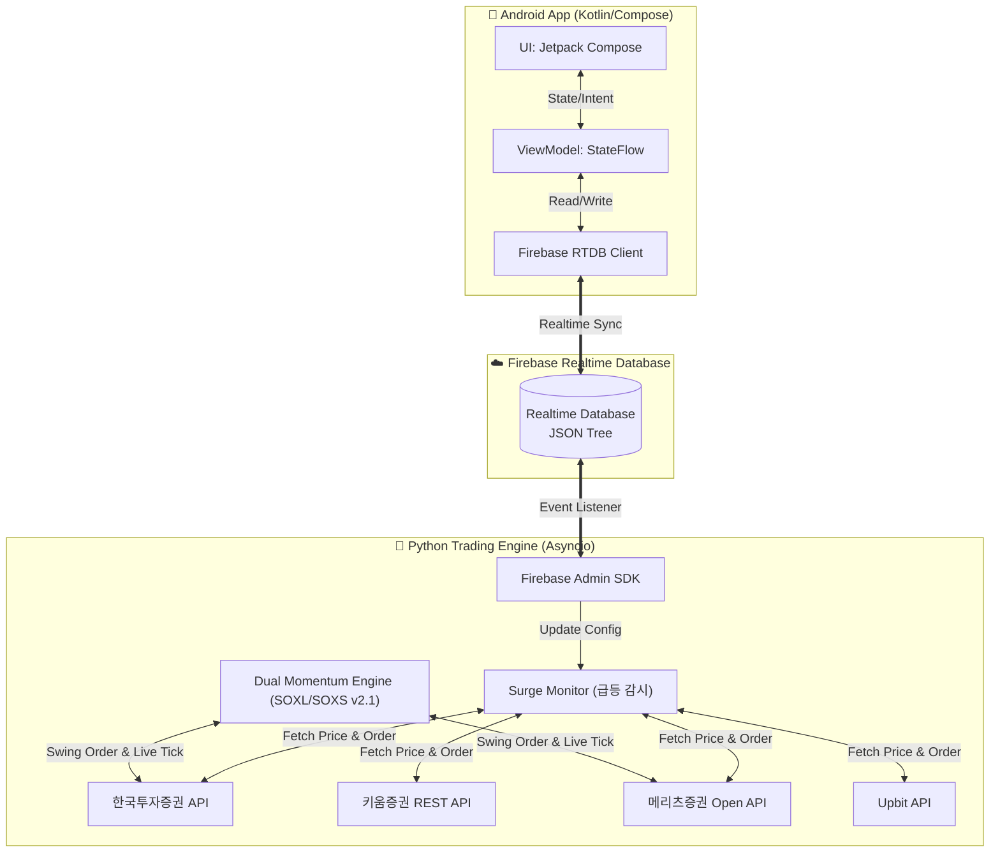

# MyAutoTrading 아키텍처 및 세부 구조 명세 (Architecture & Features)

이 문서는 개인용 주식/가상화폐 자동매매 시스템의 전체 아키텍처와 세부 데이터 흐름, 핵심 로직을 설명합니다. **향후 시스템 수정 시 본 문서를 항상 최신 상태로 유지해야 합니다.**

---

## 1. 시스템 전체 아키텍처 (System Architecture)

본 시스템은 **Android App (클라이언트)** 과 **Python Engine (백엔드 서버)** 이 완전히 분리되어 있으며, 그 사이를 **Firebase Realtime Database**가 중계하는 구조를 가집니다.

### 1.1 핵심 데이터 흐름 (Data Flow)
1. **설정 변경 (App ➡️ Firebase ➡️ Python):** 
   - 사용자가 앱에서 '감시 종목 추가', '매수 조건(시간/퍼센트/수량) 변경', '자동매매 ON/OFF' 버튼을 누릅니다.
   - 앱은 해당 내용을 JSON 포맷으로 직렬화하여 Firebase에 덮어씁니다.
   - Python 엔진은 Firebase의 `db.reference('/settings').listen()` 리스너를 통해 변경 이벤트를 실시간(0.1초 이내)으로 수신하고 내부 설정값(`user_session.py`)을 갱신합니다.
2. **시세 및 계좌 반영 (Python ➡️ Firebase ➡️ App):**
   - Python 엔진의 백그라운드 태스크가 업비트/한국투자증권 API를 지속적으로 호출하여 현재 가격, 총 자산, 보유 주식 수 등을 가져옵니다.
   - 주기적으로 Firebase의 `/status` 경로에 덮어씁니다.
   - Android 앱은 `/status` 경로의 `addValueEventListener`를 통해 상태를 즉시 넘겨받아 화면(Compose)을 다시 그립니다(Recomposition).

### 1.2 다중 사용자 및 가족 프로필 아키텍처 (Multi-Profile Architecture)
- **개념:** 한 대의 스마트폰에서 본인뿐만 아니라 가족(자녀 자녀1, 자녀2 등)의 여러 증권사 계정을 원클릭으로 전환하여 관리할 수 있는 프로필 체계입니다.
- **Firebase 노드 구조:**
  - `users/{UID}`가 곧 하나의 독립된 프로필이 되며, 하위에 `profile_name` 메타데이터(예: "내 계좌", "자녀1", "자녀2")를 보관합니다.
  - 각 프로필 하위의 `stock`, `crypto` 경로는 완전히 격리되어 브로커 API Key, 계좌번호, 자동매매 설정, 잔고가 독립적으로 관리됩니다.
- **백엔드 멀티 세션 병렬 구동:**
  - 오라클 클라우드의 `UserManager`가 `users/` 루트를 감시하여 등록된 모든 UID에 대해 각각 `UserSession`을 동시에 24시간 가동합니다.
  - 푸시 알림 전송 시 `users/{UID}/profile_name`을 조회하여 `🔔 [자녀1] 장전시간외 체결 완료`와 같이 프로필명을 알림 제목에 자동으로 부착합니다.
- **클라이언트 UI/UX (원클릭 프로필 스위처 및 상태 격리):**
  - 앱 최상단 앱바에 프로필 칩(`[👨 내 계좌] [👧 자녀1] [👶 자녀2]`)이 실시간 표시되며, 터치 한 번으로 0.1초 만에 전체 화면 데이터(주식/코인/무한매수)가 해당 프로필로 전환됩니다.
  - **프로필 전환 시 메모리 상태 즉시 초기화:** 프로필 스위치 시 이전 계정의 계좌 잔고, 보유 종목, 설정 StateFlow를 즉시 초기화(`resetUserData()`)하고 리스너를 완전히 재연결하여, 계좌가 미설정된 프로필로 전환하더라도 직전 사용자의 자산 데이터가 화면에 잔존하지 않도록 완벽히 격리합니다.
  - 신규 프로필 생성 시 Firebase 상의 중복 ID 여부를 사전에 검증하여 기존 계정 덮어쓰기를 방지합니다.
- **프로필 보안 잠금 및 기기별 PIN 저장 (Profile PIN Security & Device Persistence):**
  - 각 사용자 프로필에 PIN이 설정된 경우, 인증되지 않은 기기에서는 대시보드(총 자산, 보유 종목, 수동 주문 등)의 조회가 차단되고 잠금 화면(`ProfileLockScreen`) 및 인증 다이얼로그(`ProfilePinDialog`)가 표시됩니다.
  - 사용자가 본인 기기에서 한 번 올바른 PIN을 입력하고 "이 기기에서 PIN 저장"을 활성화하면, 기기 로컬 저장소(`SharedPreferences`)에 기록되어 이후 앱 재실행이나 프로필 전환 시 비밀번호를 다시 묻지 않고 즉시 자동 해제됩니다.
  - 타인이 앱을 설치하더라도 기기 로컬에 저장된 PIN이 없으므로 자산 및 계좌 정보 열람이 원천 차단됩니다.
- **프로필 삭제 및 백엔드 세션 종료 동기화 (Profile Deletion Lifecycle):**
  - 앱에서 프로필을 삭제할 때 현재 선택된 프로필일 경우 즉시 기본 계정(`user_main`)으로 안전 전환하여 FCM 토큰 등의 덮어쓰기를 방지합니다.
  - 백엔드 `UserManager`는 하위 속성(status 등) 변경에 의한 유령 세션 자동 생성을 차단하고, 유효한 계정 설정(`profile_name`, `account_data` 등)이 확인된 경우에만 세션을 가동합니다.
  - 삭제 이벤트 감지 시 `UserSession` 루프 및 리스너를 즉시 강제 종료하고 잔여 데이터를 영구 퍼지(Purge)하여 삭제된 계정이 백엔드 쓰기 작업에 의해 부활하는 현상을 원천 방지합니다.

---

## 2. 주요 기능 명세 (Features)

### 2.1 다중 급등주 감시 및 매매 (Surge Trading Monitor)
- **개념:** 특정 종목이 `T초` 동안 `P%` 이상 급등했을 때, 봇이 즉시 지정된 수량(`Q`)만큼 시장가(또는 지정가)로 매수하는 기능입니다.
- **다중 감시 지원:** 한 종목(예: 비트코인)에 대해 `[60초/3%/0.01개]`, `[10초/1%/0.05개]` 등 여러 개의 조건(Rule)을 동시에 걸어둘 수 있습니다.
- **연속 매수 방지 (Cooldown):** 급등이 연속으로 일어날 때 수량이 중복해서 매수되는 것을 방지하기 위해, 한 번 매수가 체결되면 해당 감시 조건은 일정 시간(또는 일시정지 상태) 동안 쿨다운에 들어갑니다.

### 2.2 수동 주문 (Manual Ordering)
- 앱에서 버튼을 눌러 즉각적으로 매수/매도/손절 주문을 서버로 쏘아 올립니다.
- Firebase의 `/commands` 경로에 주문 데이터(종목, 가격, 수량, 종류)가 Push되며, Python 서버가 이 경로를 리스닝하다가 새로운 명령이 들어오면 증권사 API를 통해 실제 주문을 실행하고 로그를 남긴 뒤 해당 명령을 데이터베이스에서 삭제(소모)합니다.

### 2.3 장전시간외 매수 대기열 선점 및 미국장 연동 자동 취소
- **개념:** 정규장 개시 전(08:20) 장전시간외 종가 매수를 위해 08:20:00.020 정각에 매수 주문을 발송하여 대기열을 선점하고, 미국 증시 시황에 따라 08:00에 주문을 미리 취소하는 지능형 스케줄링 시스템입니다. (한국투자증권 및 메리츠증권 실전 국내계좌 모두 지원)
- **네트워크 노이즈 제거 (08:19:50 Pre-fetch):** 08:20 정각 발주 시 발생할 수 있는 데이터베이스 조회 및 API 토큰 갱신 딜레이를 없애기 위해 08:19:50에 미리 예약 주문 목록을 조회하고 대상 계좌의 토큰을 사전 갱신합니다.
- **정밀 타격 및 비동기 병렬 발주:** `engine/reservation_manager.py`가 08:20:00.000 정각까지 대기한 후, 증권사 서버의 미세한 지연(Clock Drift)을 고려하여 08:20:00.020에 asyncio를 통해 모든 사용자/종목 주문을 병렬로 동시 발주(KIS `ORD_DVSN: 05`, 메리츠 `oder_cls_code: 61`)합니다.
- **미국장 연동 자동 취소 (08:00 스케줄러):** 국내 상장 해외 ETF를 대상으로, 평일 15:30 기준가 스냅샷(한국투자/메리츠 실전 해외계좌 시세 연동)과 다음날 05:00 정규장 마감가 스냅샷을 비교합니다. 08:00에 상위 구성 종목들의 밤사이 등락률을 산술 평균하여, 기준치 미만일 경우 주문을 자동 취소합니다. (주말 및 휴일에는 스케줄러와 스냅샷이 작동하지 않도록 영업일 필터링 적용)

### 2.4 라오어 무한매수법 대시보드 및 실시간 잔고 동기화 (Laore Dashboard & Balance Sync)
- **평단가 vs 현재가 비교:** `MainActivity.kt`의 무한매수 카드 레이아웃에 실제 보유 평단가와 시장 실시간 현재가를 나란히 배치하여 즉각적인 손익 및 단가 비교를 제공합니다.
- **실계좌 잔고 동기화:** `user_session.py`의 `_run_laore_schedule` 루프가 실행될 때 국내 주식 및 코인 계좌의 실잔고(`get_balance`)를 1:1로 조회하여 `laore_status`의 평단가와 보유수량을 실제 계좌 잔고 데이터와 동기화합니다.

### 2.5 SOXL / SOXS 양방향 퀀트 스윙 전략 (`v2.1 Final Production`)
- **개념:** 단일 증권 계좌(메리츠/KIS 등)에서 미국 필라델피아 반도체 3배 레버리지 ETF(`SOXL`)와 인버스 3배 ETF(`SOXS`) 중 **항상 1개 종목만 상호배타적으로 집중 보유**하여 운용하는 퀀트 스윙 매매 시스템입니다.
- **6.75년 142만 분봉 및 6,400회 몬테카를로/파라미터 전수 검증:**
  - 2020~2026년 데이터 감사, 파라미터 지터(100시드), 1분봉 호가 섭동(100시드), EXP-10 심층 스캔(4,100회)을 거쳐 **연평균 60~70% 복리 성장(Trail Gap 0.7% 최적화 적용 시 MC 중앙값 +7,169%), MDD -35%~-43%의 방어선**을 수학적으로 완벽히 입증했습니다.
- **핵심 동작 메커니즘 (`v2.1 Final Production` 확정 규격):**
  1. **거시 국면 판정**: 전일 `SOXX > 200MA` 시 상승장(SOXL 목표가 +18%, SOXS +15%), 이하 시 하락장(양방향 +12%). 미국 동부시간 기준 당일 개장 전 마감 봉(`bar_date < today_et`)을 필터링하여 일관된 일봉 레짐 산출.
  2. **RSI 역추세 함정 방어**: 전일 `SOXX RSI >= 65` 시 SOXL 신규 진입 차단, `RSI <= 38` 시 SOXS 신규 진입 차단 (무포지션 첫 진입 시 적용).
  3. **4단계 분할 매수**: Condition 2(정규장 -2%/-3% 또는 -3%/-4%, 10%씩), Condition 1(전시간대 -9% 20%, -10% 10%). 현금 20% 이하 시 각 5%로 자동 축소.
  4. **공격적 지정가 주문 (Marketable Limit Order)**: 매수 시 현재가 +$0.03, 매도 시 -$0.03으로 지정가 버퍼를 적용. 미국 거래소 NBBO(최유리 가격 체결) 원칙에 따라 실질적으로 최우선 호가에 체결되면서 V자 반등 시의 미체결 슬리피지를 원천 방지.
  5. **미체결 감시 및 정합성 보정 (Order Reconciliation)**: 발주 12초 후 실제 증권사 잔고(`get_balance`)를 실측하여, 미체결 잔량이 존재할 경우 `cancel_overseas_order`로 즉시 취소하고 체결 수량만 상태에 동기화. 완전 미체결 취소 시 해당 레벨의 매수 플래그를 자동 복구하여 재진입 기회 보장.
  6. **손절 방어**: 순수 평가손실 `-5.0%` 이하가 **2분봉 연속 지속**될 때 시장가 손절 (`-6.5%` 직행 시 즉시 안전핀 손절).
  7. **트레일링 익절**: 목표가 도달 시 **50% 즉시 분할 매도**, 이후 `0.7%` 트레일링 갭을 유지하며 `+1.0%p` 추가 상승 시마다 **10%씩 분할 매도**. 장마감 직전(19:50 ET) 잔여분 전량 청산.
- **공식 실전 상용화 사양서:** [11_V2_1_FINAL_PRODUCTION_SPECIFICATION.md](./py-my-auto-trading/docs/backtest/11_V2_1_FINAL_PRODUCTION_SPECIFICATION.md) 참조.

### 2.6 폰앱 4번째 탭 '⚡ 퀀트스윙' 모니터링 및 실시간 제어 화면 (`QuantSwingScreen.kt`)
- **개념:** 기존 기능(주식, 코인, 무한매수)에 영향을 주지 않는 독립된 4번째 탭으로, SOXL/SOXS 스윙 v2.1 전략이 적용된 계좌의 포지션, 시장 레짐, 당일 분할 매수 현황, 체결 내역을 실시간으로 감시하고 제어할 수 있는 전용 대시보드입니다.
- **주요 UI 컴포넌트:**
  1. **전략 헤더 & 자동매매 스위치**: 실시간 엔진 가동 여부(`🟢 가동 중` / `⚪ 정지됨`), 적용 계좌명 및 계좌번호, 자동매매 토글 스위치.
  2. **반도체 시장 국면 카드 (SOXX Macro)**: 전일 200MA 돌파 여부에 따른 `BULL(🐂)` / `BEAR(🐻)` 레짐 및 실시간 `SOXX RSI(14)` 수치 표시.
  3. **실시간 포지션 카드**: 현재 진입 종목(`SOXL 3x Bull` / `SOXS 3x Bear` / `관망 중`), 보유 수량, 평단가, 현재가, 실시간 손익률(%) 및 평가손익(USD), 보유 일수(N일차), 익절 목표가(TP), 트레일링 스탑가, 손절가(-5.0%) 표시.
  4. **당일 4단계 분할 매수 현황 (4-Tier Progress)**: 1차(-2%/-3%), 2차(-3%/-4%), 3차(-9%), 4차(-10%) 체결 여부(체결됨 ✅ / 대기 ⏳) 시각화.
  5. **실시간 체결 내역 (Trade History)**: 최근 발생한 매수/매도/익절/손절 체결 시간, 종목, 수량, 단가, 손익률, 사유 리스트 실시간 표시.
  6. **비상 전량 시장가 청산 버튼**: 포지션 보유 시 원클릭으로 증권사에 전량 시장가 매도 주문을 발주하고 포지션을 즉시 리셋하는 안전 제어 장치.
- **Firebase 노드 구조:**
  - `users/{UID}/stock/accounts/{account_id}/dual_momentum/settings`: 활성화 여부, 운용 예산, 목표 익절률, 손절률.
  - `users/{UID}/stock/accounts/{account_id}/dual_momentum/status`: 실시간 포지션, 수량, 손익률, 레짐, RSI, 당일 분할 체결 단계.
  - `users/{UID}/stock/accounts/{account_id}/dual_momentum/trades`: 실시간 체결 로그 목록.
  - `users/{UID}/stock/accounts/{account_id}/dual_momentum/command`: 비상 청산(`EMERGENCY_CLOSE`) 명령 수신.

---

## 3. 폴더 및 파일 구조 (Directory Structure)

### 3.1 Android App (`AutoTradingApp/`)
- **UI 계층 (`MainActivity.kt` 등):** Jetpack Compose로 전면 작성되어 있습니다. `StockTradingScreen`, `CryptoTradingScreen` 등의 컴포저블(Composable) 함수들로 화면이 구성됩니다.
- **상태 관리 (`TradingViewModel.kt`):** `MutableStateFlow`를 이용해 화면의 상태를 관리하고, 사용자의 입력을 받아 Firebase 저장 로직을 호출합니다.
- **데이터 모델 (`TradingModels.kt`):** Firebase와 통신하기 위한 데이터 클래스들이 정의되어 있습니다. Kotlin Serialization이나 Gson 등의 역할을 직접 담당합니다. (예: `SurgeTradingConfig`, `StockStatus` 등)

### 3.2 Python Engine (`py-my-auto-trading/`)
- **`my-auto-trading.py` (엔트리 포인트):** 메인 실행 파일이며, 로거(Logger) 세팅 및 모든 백그라운드 루프(asyncio.gather)를 실행시킵니다.
- **`engine/user_manager.py`:** 다중 사용자 세션을 관리합니다. Firebase의 `users` 경로를 리스닝하여 사용자별 주식/코인 세션을 자동으로 생성하고 파괴합니다. 하위 경로 삭제 시 세션이 잘못 종료되지 않도록 보호 로직이 포함되어 있습니다.
- **`engine/dual_momentum_engine.py`:** SOXL/SOXS v2.1 단일 계좌 스윙 알고리즘의 순수 수학/규칙 엔진 (4단계 분할 진입, RSI 필터, 200MA 레짐, T-Decay 감쇠, 0.7% 트레일링 익절, 2분봉 -5% 손절).
- **`engine/dual_momentum_controller.py`:** Firebase와 브로커(KIS/Meritz)를 연결하여 실시간 시세 구독, 매크로 지표(SOXX 200MA/RSI) 자동 계산, 실거래 주문 발주, 체결 내역 및 실시간 상태를 Firebase에 동기화하는 백엔드 오케스트레이터.
- **`engine/user_session.py`:** Firebase와의 통신을 전담하며, 상태(Status)를 업데이트하거나 앱에서 넘어오는 명령(Commands)과 설정(Settings)을 콜백으로 받아 처리합니다.
- **`engine/reservation_manager.py`:** 장전 시간외 매수 주문예약 데이터를 감시하고 도달 시점에 자동 매수 주문을 발주하는 스케줄러 모듈입니다. 한국투자증권 및 메리츠증권 실전 계좌를 모두 지원하며 일회용(Ghost) 브로커의 HTTP 세션을 안전하게 정리합니다.
- **`engine/etf_analyzer.py`:** 미국/국내 대표 ETF(TIGER 미국테크TOP10 등) 구성 종목 및 비중 정보를 분석하고 크롤링/가공하는 데이터 모듈입니다.
- **`brokers/kis_broker.py`:** 한국투자증권(KIS) REST API 래퍼. 토큰 캐싱(`.kis_token_*.json`)을 지원하여 계좌 전환 시 재인증 지연을 방지합니다.
- **`brokers/kiwoom_broker.py`:** 키움증권 REST API 래퍼. 실전/모의 투자 도메인 자동 분기(`api.kiwoom.com` / `mockapi.kiwoom.com`), 잔고조회(`kt00004`, `kt00018`), 주문/취소(`kt10000`, `kt10001`, `kt10003`), 웹소켓 실시간 시세(`0B`) 지원.
- **`brokers/meritz_broker.py`:** 메리츠증권 Open API 래퍼. JWT `exp` 클레임 기반 정확한 토큰 만료 관리 및 캐싱(`.meritz_token_*.json`), 토큰 무효(`EGW00121`) 시 자동 재발급 재시도, 국내/해외 예수금 및 보유종목 조회(`deposit`, `holdings`, `overseas/currencies`, `overseas/holdings`), 국내 및 해외(미국 나스닥/NYSE/AMEX) 주식 매수/매도/취소/체결조회(`orders_buy`, `orders_sell`, `orders_today`, `overseas/orders/*`), 장전시간외(`61`) 및 라오어 무한매수법 LOC(`32`)/시장가/지정가 주문, 웹소켓 실시간 체결가 구독(국내 `ohhts_stck_cntg`, 해외 `ohhts_exst_cntg`) 지원.
- **`brokers/upbit_broker.py`:** Upbit 코인 거래소 API 래퍼. 웹소켓을 통한 실시간 체결가 수신을 지원합니다.
- **`models/schemas.py`:** Python 측 데이터 모델 클래스들(Pydantic 또는 Dataclass)이 정의되어 있으며, Android의 `TradingModels.kt`와 구조가 1:1로 매칭되어야 합니다.

### 3.3 배포 및 운영 스크립트
- **`deploy.bat`:** 모든 파이썬 소스를 Oracle Cloud 서버에 업로드하고 엔진을 재시작하는 일괄 배포 스크립트.
- **`server.bat`:** 서버 관리 통합 스크립트 (`deploy`, `upload`, `restart`, `log`, `ssh`, `status` 서브커맨드 지원).

---

## 4. 지원 증권사/거래소

| 증권사/거래소 | 자산 유형 | 실전/모의 | API 방식 |
|---|---|---|---|
| 한국투자증권 (KIS) | 국내주식, 해외주식 | 실전 + 모의 | REST + WebSocket |
| 키움증권 | 국내주식 | 실전 + 모의 | REST + WebSocket |
| 메리츠증권 | 국내주식, 해외주식 | 실전 | REST + WebSocket |
| 업비트 (Upbit) | 가상화폐 | 실전 | REST + WebSocket |

---

## 5. 향후 확장 및 유지보수 가이드
- **새로운 증권사 추가 시:** `brokers/base_broker.py`의 `BaseBroker` 추상 클래스를 상속하여 새 브로커를 구현하고, `engine/user_session.py`의 `_setup_broker()`에 분기 로직을 추가합니다.
- **새로운 설정 필드 추가 시:** 안드로이드의 `TradingModels.kt`와 파이썬의 `schemas.py` 양쪽에 동시에 새로운 변수(Property)를 추가해야 Firebase 직렬화/역직렬화 시 에러가 나지 않습니다.
- **토큰 캐싱:** KIS와 키움증권 모두 Access Token을 로컬 파일에 캐싱합니다. 계좌 전환 시 불필요한 재인증(1분+ 지연)을 방지하기 위한 핵심 최적화입니다.
- **키 관리:** 절대 GitHub나 외부에 `keys.json`, `google-services.json`의 원본 데이터를 올리지 마세요. 템플릿 파일 구조만 유지합니다.

